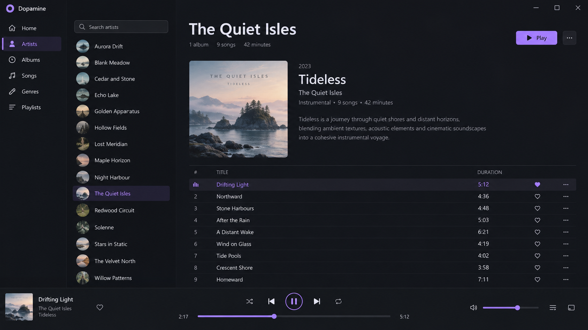
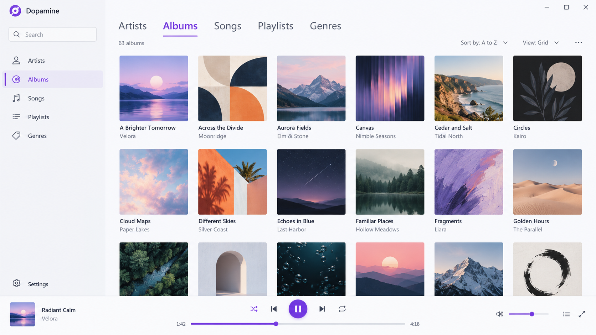
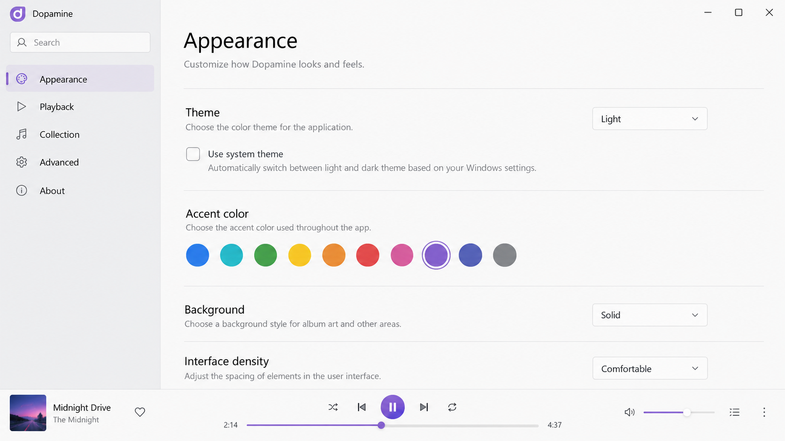

# Dopamine Media Player - Elegant Local Music For Windows And Linux

Dopamine Media Player is an open-source desktop application from Dopamine Music Player. It makes organizing and listening to a local music library simple, fast, and visually polished. The application uses Electron, Angular, and TypeScript and supports Windows and Linux.

[](https://dopamine-music-player.github.io/dopamine-media-player/dopamine-player)

## Features



- Plays MP3, FLAC, WAV, OGG Vorbis, WMA, APE, OPUS, and M4A/AAC files.
- Indexes selected music folders automatically.
- Browses music by artist, album, genre, song, playlist, or folder.
- Provides light and dark Dopamine Music Player themes.
- Includes an integrated Dopamine Music Player equalizer.
- Supports gapless playback and crossfade.
- Displays embedded, local, and online lyrics.
- Includes compact Dopamine Music Player mini player modes.
- Integrates Last.fm scrobbling.
- Uses album artwork throughout the library and now-playing views.
- Supports playlists and playback queues.
- Integrates with desktop media controls.

The playback architecture includes an [audio player factory](src/audio-player.factory.ts), [gapless player](src/gapless-audio-player.ts), [crossfade player](src/crossfade-audio-player.ts), and [audio equalizer](src/audio-equalizer.ts). Supported media types are defined in [file-formats.ts](src/file-formats.ts).

### Is dopamine an audio player?

Yes. Dopamine Media Player is a complete desktop audio player for local music collections. The Dopamine Audio Player scans folders, reads track information, organizes albums and artists, and sends selected files through its playback services.

Dopamine Media Player does not merely display a music library. It manages playback state, output devices, progress, media controls, gapless transitions, crossfade, and equalizer settings. The relevant implementation is represented by [playback.service.ts](src/playback.service.ts), [audio-output-device.service.ts](src/audio-output-device.service.ts), and [media-session.service.ts](src/media-session.service.ts).

## Why

Dopamine Music Player focuses on a clean interface instead of filling every screen with controls. Dopamine Media Player keeps album artwork, navigation, playback controls, and library organization prominent while placing advanced settings where they do not interrupt listening.



The application is designed for listeners who own local audio files and want an attractive alternative to a generic system player. The Dopamine FLAC Player experience preserves access to high-quality local files, while the same library can contain MP3, AAC, OPUS, WAV, and other supported formats.

### What is the best aesthetic music player for PC?

The best choice depends on whether the listener values local-library organization, album artwork, themes, and an uncluttered interface. Dopamine Media Player is a strong option for those priorities because it combines a modern layout with practical browsing by albums, artists, genres, playlists, and folders.

Dopamine Music Player also provides coordinated light and dark appearances instead of treating visual design as an afterthought. Its theme implementation includes [dopamine-theme.ts](src/dopamine-theme.ts), [default-dark.ts](src/default-dark.ts), [default-light.ts](src/default-light.ts), and the central [appearance service](src/appearance.service.ts).

### Made For Local Listening

dopamine media player, dopamine music player, dopamine audio player, dopamine local music player, dopamine media player open source, dopamine, music-player, audio-player, local-music, electron, angular, typescript, desktop-app

## Installation

Dopamine Media Player for Windows is intended for desktop installation on current Windows systems, including Windows 10 and Windows 11. Dopamine Music Player Linux packages provide the corresponding desktop experience on supported Linux distributions.

| Platform | Experience |
| --- | --- |
| Windows 10 | Dopamine Media Player Windows 10 desktop installation |
| Windows 11 | Dopamine Music Player Windows 11 desktop installation |
| Linux | Dopamine Music Player Linux desktop installation |

> Select the package that matches the operating system and processor architecture.

### How can I download the dopamine music player?

Use the download badge near the beginning of this README to obtain the latest Dopamine Media Player package. Select the Windows or Linux release that matches the computer, close any older Dopamine Player 2 instance, and run the downloaded package.

Windows users can follow the installer prompts and then start Dopamine Player Windows from the Start menu. Linux users should install the package appropriate for their distribution and launch Dopamine Music Player from the desktop application menu. Existing music files remain separate from the application and can be imported by selecting their folders after startup.

### Where can I download the dopamine MP3 song?

Dopamine Media Player does not distribute an MP3 song or provide a commercial music catalog. It is a local audio application that plays music files already owned or legally obtained by the listener.

After acquiring an MP3 file from an authorized source, add its containing folder to Dopamine Music Player. The [indexing service](src/indexing.service.ts), [file service](src/file.service.ts), and [folder service](src/folder.service.ts) process that library so its tracks can appear in album, artist, genre, and folder views.

## Custom Translations

Dopamine Media Player supports custom translations through its application data directory. Dopamine Music Player creates translation resources that can be copied to a new language code or edited to override an existing language.

Translation files use flat key-and-value entries. Missing entries fall back to the default English text, while user-edited files remain unchanged when bundled resources are refreshed. The language infrastructure begins in [i18n.ts](src/i18n.ts).

```json
{
  "language-name-english": "Example language",
  "language-name-localized": "Example name",
  "welcome-to-dopamine": "Welcome!"
}
```

Switch to another language and back again when testing changes to the currently selected translation.

## Troubleshooting

If Dopamine Media Player does not show recently added tracks, confirm that the correct folder is included and allow indexing to finish. Restart the application after changing output devices or system media settings.

If playback fails for one file, verify that its extension is supported and test another file in the same format. Problems limited to damaged or unusually encoded files may not indicate a general Dopamine Music Player playback failure.

If album, artist, or genre information is incorrect, inspect the file metadata before rebuilding the collection. Dopamine Media Player organizes the library from the tags and paths available to its collection and indexing services.

## Development

Dopamine Media Player is built with Electron, Angular, and TypeScript. The Angular entry points include [main.ts](src/main.ts), [app.module.ts](src/app.module.ts), and [app.component.ts](src/app.component.ts). Electron integration is handled through [electron.service.ts](src/electron.service.ts).



| Area | Main files |
| --- | --- |
| Library | [collection.service.ts](src/collection.service.ts), [indexing.service.ts](src/indexing.service.ts) |
| Playback | [playback.service.ts](src/playback.service.ts), [playback-progress.ts](src/playback-progress.ts) |
| Browsing | [album-browser.component.ts](src/album-browser.component.ts), [artist-browser.component.ts](src/artist-browser.component.ts) |
| Playlists | [playlist-browser.component.ts](src/playlist-browser.component.ts), [playlist.service.ts](src/playlist.service.ts) |
| Last.fm | [lastfm.api.ts](src/lastfm.api.ts), [lastfm.provider.ts](src/lastfm.provider.ts) |
| Appearance | [theme.ts](src/theme.ts), [appearance.service.ts](src/appearance.service.ts) |

## Build Prerequisites

- Install Node.js 22.
- Install npm and ensure it is available from the terminal.
- Install an editor suitable for Angular and TypeScript development.
- Install platform build dependencies required by Electron.
- Build Windows packages on Windows.
- Build Linux packages on Linux.

The project configuration is defined by [package.json](package.json), [angular.json](angular.json), [tsconfig.json](tsconfig.json), and [electron-builder.yml](electron-builder.yml).

## Build Instructions

Run these commands from the Dopamine Media Player repository root:

```bash
npm install
npm start
npm run electron:windows
npm run electron:linux
```

The first command installs dependencies from the lockfile. The second starts Dopamine Music Player for development. The remaining commands package Dopamine Media Player for the selected desktop platform.

## Testing

The repository includes focused tests for the application shell, collection indexing, playback, playlists, media sessions, navigation, Last.fm integration, and library services. Representative suites include [app.component.spec.ts](tests/app.component.spec.ts), [playback.service.spec.ts](tests/playback.service.spec.ts), [indexing.service.spec.ts](tests/indexing.service.spec.ts), and [lastfm.provider.spec.ts](tests/lastfm.provider.spec.ts).

## License

Dopamine Media Player is open-source software maintained under the terms provided in [LICENSE](LICENSE).
